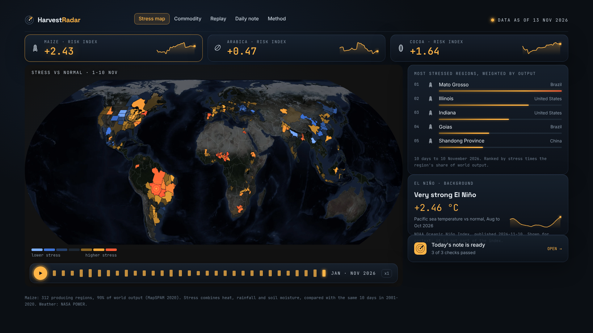

<p align="center"></p>

# HarvestRadar

**See the harvest shock before the price does.** Weather where crops grow, one number per commodity, every week.

HarvestRadar measures heat, rain and soil moisture in the provinces that grow most of the world's maize,
arabica coffee and cocoa, during the few weeks that decide each harvest. A gradient-boosting model turns them
into an expected production gap per country, and the world gap becomes a **harvest-risk index** (`risk_z`):
zero is a normal season, above +2 is rare. Every working day a small open model from Hugging Face, running
locally, writes a plain-English note in which every figure is inserted by software, with its source. The app
also translates the expected supply gap into the price move it has historically come with.



> Research output, not investment advice.

## Run the demo (offline, 3 commands)

```bash
make setup     # Python 3.11, pinned environment (requirements.lock)
make demo      # app on http://localhost:8501, reads data/demo only, zero external requests
make test      # unit tests on synthetic data, plus data contracts of data/demo
```

`make offline-check` starts the app, opens every page, presses play on the maps and fails on any request
that leaves localhost. `make screenshots` captures every page at 1920 x 1080 (device scale factor 2).

## What is in the app

| Page | What it shows | Data |
|---|---|---|
| Stress map | Live ticker, producing regions on a NASA Blue Marble base (Equal Earth), dekad scrubber with play, hotspot rings, top 5 regions by stress x share of world supply, El Nino context, Friday note status | `stress_<crop>.parquet`, `regions_<crop>.geojson`, `risk_index.parquet`, `oni.parquet`, `notes.parquet` |
| Commodity | Harvest-risk index, expected world supply vs normal, futures price, what it means for the price (implied move and range), index vs price over 64 weeks with the critical windows of the main producer, which countries drive today's reading, which weather drives each country's forecast (SHAP) | `risk_index.parquet`, `prices_<crop>.parquet`, `shap_latest.parquet`, `config/commodities.yaml` |
| Replay | US drought 2012, Brazil frost 2021, cocoa 2023-2024: dekad stress film strip, first crossing of +2, index path, price | `events.json`, `stress_<crop>.parquet` |
| Daily note | Inbox of the last five working days, the note with figure pills, the three checks, the data given to the model, **Download as email** | `notes.parquet` |
| Method | Pipeline in four steps, out-of-sample evaluation, the honest record, credits | `model_eval.json`, `events.json`, `backtest.json` |

URL state for filming: `?page=commodity&crop=maize&date=2026-11-13&dekad=2012-06-10&episode=us_drought_2012`,
plus `&capture=1` to freeze animations and turn off hovers, `&play=1` to start the map playing, `&data=1` to
open the data panel of the note.

## Rebuild everything from public data

```bash
make data      # FAOSTAT, NOAA ONI, futures (yfinance), regions, NASA POWER (about 2,000 grid cells)
make features  # region and country series, dekad stress, weekly country-season features
make train     # rolling-origin LightGBM vintages, baselines, evaluation, SHAP
make index     # risk index (weekly history and every working day), episodes, backtest, price reaction
make notes     # daily notes (needs: pip install -r requirements-llm.lock, downloads Qwen2.5-1.5B once)
make export    # writes data/demo (< 50 MB)
make email     # writes reports/notes/<week>_<crop>.eml and .html
```

**One manual step**: MapSPAM 2020 sits behind a Harvard Dataverse guestbook. Download
`spam2020V2r2_global_production.geotiff.zip` from https://doi.org/10.7910/DVN/SWPENT, and put the three files
`*_P_MAIZ_A.tif`, `*_P_COFF_A.tif` (arabica), `*_P_COCO_A.tif` in `data/raw/spam/`.

Every download is recorded in `data/manifest.json` (URL, date, licence, SHA-256). Sources and licences:
[docs/data_sources.md](docs/data_sources.md). User guide: [docs/user_guide.md](docs/user_guide.md).

## How it works

```
MapSPAM 2020 x geoBoundaries ADM1 -> regions covering 90 % of world output, production weights
NASA POWER daily (1981 ->)        -> region and country series -> dekad stress map (vs 2001-2020)
                                   -> weekly country-season features "as of" each Friday (no look-ahead)
FAOSTAT yields and production     -> anomalies vs a trend fitted on earlier years only
LightGBM (3 crops, one model)     -> rolling-origin vintages: year V trained on seasons published before V
                                   -> expected anomaly per country, 10-90 % band, SHAP
World index                        -> dP = sum(share x anomaly); risk_z = -(dP - mean) / sd, where mean and sd
                                      come from the same model re-forecasting the same weeks of the past 15 years
Daily note                         -> Qwen2.5-1.5B writes with slots, software inserts sourced figures,
                                      numbers / context / claims checks, deterministic template fallback
```

Method decisions and the honest record: [docs/method_notes.md](docs/method_notes.md).
Code: `src/harvestradar/{ingest,geo,features,models,signal,report,app}`. Specification: [SPEC.md](SPEC.md).
App guidelines: [docs/app_guidelines.md](docs/app_guidelines.md). Prompts used with AI tools:
[docs/prompts_log.md](docs/prompts_log.md).

## Credits

Data: NASA POWER, MapSPAM 2020 (IFPRI), geoBoundaries, FAOSTAT, NOAA CPC, Yahoo Finance (yfinance),
Natural Earth. Imagery: NASA Blue Marble. Model: LightGBM, SHAP; weekly note by Qwen2.5-1.5B-Instruct
(Hugging Face, Apache 2.0). App: Streamlit, Plotly. Fonts: Space Grotesk, Inter, JetBrains Mono (SIL OFL).
Advanced AI Algorithms, ESSEC Business School.

## Web edition (no Python needed)

`python scripts/build_web.py` writes `dist/web/index.html`: one self-contained page (about 3 MB) with the five
pages, the same data snapshot and the same map code, for viewing in a browser or publishing as a page.
Differences with the Streamlit app: the weekly email is shown in the page instead of downloaded, and fonts
load from Google Fonts.
